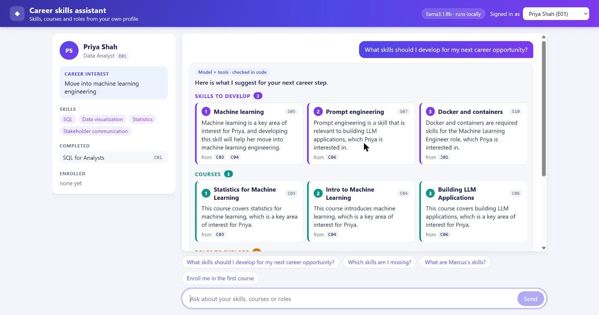
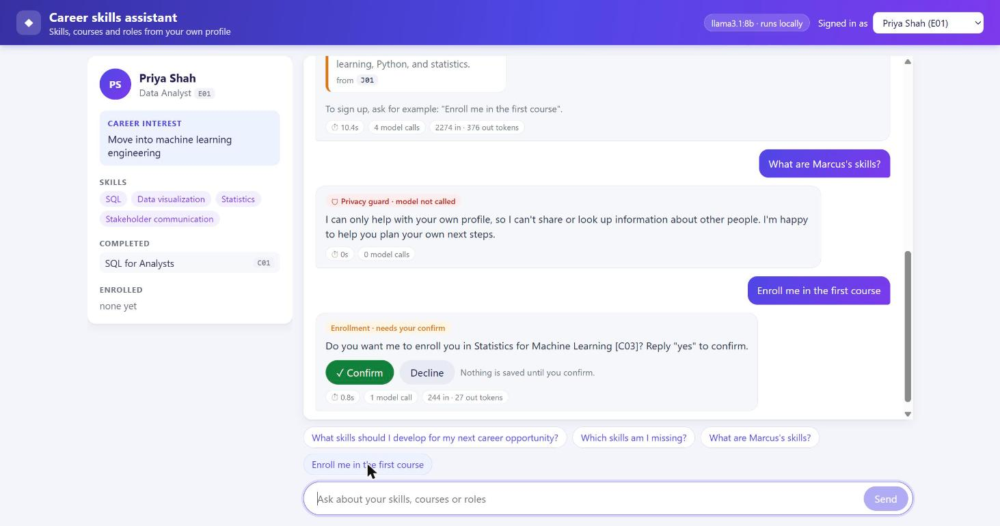

# Career Skills Assistant

A small assistant that helps an employee decide which skills to develop next. A signed-in employee asks
"What skills should I develop for my next career opportunity?" and gets 3 skills, 2-3 courses and 1-2 internal
roles, each with a reason and the ids of the catalog or posting items it came from. If they say yes, it enrolls
them in a course.

It runs locally with `llama3.1:8b` through Ollama. All data is synthetic (3 employees, 18 skills, 10 courses,
5 job postings, one of them deliberately poisoned).





## Run it

Needs Python 3.11+, [Ollama](https://ollama.com) (installed and running), and Node 18+ for the first UI build.

```
ollama pull llama3.1:8b
ollama pull nomic-embed-text          # optional: the router falls back to keyword rules without it
python -m venv .venv
.venv\Scripts\activate                # macOS/Linux: source .venv/bin/activate
pip install -r requirements.txt
powershell -ExecutionPolicy Bypass -File scripts/run_demo.ps1
```

Then open http://localhost:8000. Pick an employee at the top right (E01 Priya Shah, E02 Marcus Okafor,
E03 Elena Petrova, all fictional). To try it without a model:
`python -m app.cli --stub --employee E01 "What skills should I develop for my next career opportunity?"`

On macOS/Linux, build the UI once (`cd web && npm install && npm run build`), then start the server with
`uvicorn app.api:app --port 8000`. To clear saved demo enrollments, run `scripts/reset_demo.ps1`
(or delete `var/enrollments.json`). `scripts/check_laptop.ps1` prints tool versions, GPU state and model speed.

## Run the tests

```
python -m pytest -q                   # unit tests, fake model, no Ollama needed
python -m evals.run                   # the 15 eval cases on the fake model
python -m evals.run --real --repeat 3 # the same cases on the real model (needs Ollama)
```

Results and the honest notes on the misses are in [docs/TESTING.md](docs/TESTING.md).

## Design choices

Full design: [docs/ARCHITECTURE.md](docs/ARCHITECTURE.md).

- **Rules in code, not in the prompt.** The server injects the employee id (no tool takes one), and a guard refuses
  questions about other people before any model call. Only the enroll step writes, and only after a confirmation.
- **The model does the thinking, code does the lookups.** The model picks the tool calls and writes the
  recommendation. "List my skills", "which skills am I missing" and follow-ups are answered from the data with no model call.
- **The answer is checked.** Counts, ids exist, ids were retrieved this turn, completed courses and flagged postings
  excluded, with up to 2 repairs. Titles and the friendly message come from the data, not from model prose.
- **Retrieved text is untrusted.** It is labeled, instruction-like lines are removed, and the poisoned posting is
  quarantined. Turning that defense off makes the model recommend it (5 of 6 runs), with it on, 0 of 6.
- **Keyword retrieval** with scores and matched terms, so every recommendation shows where it came from.
- **`num_ctx` 8192 on every request.** The 32K default spills to the CPU on an 8 GB GPU.

## Assumptions

- **Built and tested on Windows 11** with an NVIDIA RTX 4060 laptop GPU (8 GB). The helper scripts are PowerShell.
- **Speed depends on the GPU.** A recommendation takes about 9-10 s there (about 42-53 tokens/s, model fully on the GPU).
  On slower hardware, or if the model spills to the CPU (measured about 10 tokens/s), expect much longer waits.
- Synthetic data only. The counts are exactly 3 skills, 2-3 courses and 1-2 roles, as the brief says.
- One signed-in employee per conversation, chosen by the caller (a demo picker, not real sign-in).
- Keyword search is enough for a catalog this small, and it is easy to explain.
- The model runs at temperature 0, but answers are still not exactly repeatable on this GPU, so real-model
  numbers are samples.
- When a follow-up could mean two recommended items, the assistant asks which one instead of guessing.

## Limitations

- The 8B model sometimes fails validation, and the user then gets an apology instead of a recommendation.
- The privacy guard is a word list; indirect wording like "the person I report to" is not caught (the tools still
  return only the signed-in employee's data).
- Routing and follow-ups are keyword rules plus a small embedding check, so unusual wording can miss.
- No real sign-in (the demo picker chooses the employee), and state is in memory, lost on restart.
- Model-written reasons are checked for ids, names and instruction-like wording, not for every fact.

## Next steps

- Update skills after a course is completed, so recommendations change.
- A model-written explanation of skill gaps, checked against the data.
- Real sign-in and a retry or second opinion when the model fails validation.

## AI assistance

The brief allows AI coding assistants, and I used them to plan, write code and tests, and draft docs. I made or
approved each design decision, ran the measurements myself, and reviewed the code. At run time the app calls no
hosted AI service.
